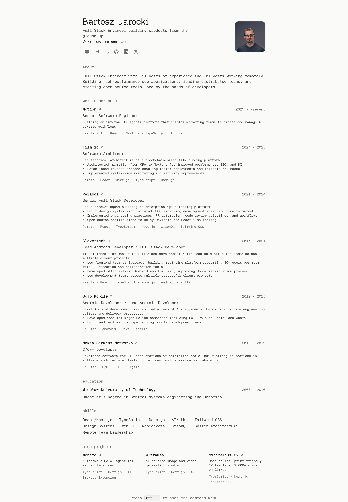

<h1>minimalist cv <a href="https://vercel.com/new/clone?repository-url=https%3A%2F%2Fgithub.com%2FBartoszJarocki%2Fcv"></a></h1>

[](https://nextjs.org/)
[](https://www.typescriptlang.org/)
[](https://tailwindcss.com/)

simple web app that renders a minimalist CV with print-friendly layout.

maintained by an ai robot 🤖, with a human pressing merge.

## requirements

- node 22.15 or later. `pnpm verify` refuses to run on older versions.
- pnpm

## getting started

```bash
git clone https://github.com/BartoszJarocki/cv.git
cd cv
pnpm install
pnpm dev
# open http://localhost:3000
# edit src/data/resume-data.ts to customize
```

## scripts

```bash
pnpm dev          # start development server
pnpm build        # build for production
pnpm start        # start production server
pnpm lint         # run biome linting checks
pnpm lint:fix     # run biome linting with auto-fix
pnpm format       # check code formatting with biome
pnpm format:fix   # format code with biome
pnpm check        # run both linting and formatting checks
pnpm check:fix    # run both linting and formatting with auto-fix
pnpm verify       # check the page, text and markdown that pnpm build prerendered
```

## project structure

```
scripts/
└── verify.mjs          # checks run by pnpm verify
src/
├── app/                # next.js app router
│   ├── components/     # page-level components
│   │   ├── education.tsx
│   │   ├── header.tsx
│   │   ├── projects.tsx
│   │   ├── skills.tsx
│   │   ├── summary.tsx
│   │   └── work-experience.tsx
│   ├── index.md/
│   │   └── route.ts    # the CV as markdown
│   ├── index.txt/
│   │   └── route.ts    # the CV as text, for curl
│   ├── llms.txt/
│   │   └── route.ts    # the markdown, with a note on the formats
│   ├── apple-icon.png  # home screen icon
│   ├── favicon.ico     # browser tab icon
│   ├── globals.css     # color palette and base styles
│   ├── layout.tsx      # root layout with metadata
│   ├── opengraph-image.tsx
│   ├── page.tsx        # main resume page
│   ├── robots.ts
│   └── sitemap.ts
├── components/         # shared components
│   ├── icons/          # social icon components
│   ├── ui/             # presentational components
│   ├── command-menu-dialog.tsx
│   └── command-menu.tsx
├── data/               # resume data configuration
│   ├── avatar.jpg      # your photo
│   └── resume-data.ts
└── lib/                # utilities and types
    ├── document.ts     # the CV as blocks for the text and markdown
    ├── markdown.ts
    ├── resume.ts
    ├── structured-data.ts
    ├── text.ts
    ├── types.ts
    └── utils.ts
```

## customization

all resume content lives in a single file:

```typescript
// src/data/resume-data.ts
export const RESUME_DATA = {
  name: "Your Name",
  location: "Your City, Country",
  siteUrl: "https://cv.example.com", // where this CV is deployed
  about: "One line under your name", // also the meta description and share image text
  summary: "A paragraph for the About section",
  // ... more fields
}

export const SECTION_TITLES = {
  summary: "About",
  work: "Work Experience",
  // ... education, skills, projects
}
```

`SECTION_TITLES`, in the same file, holds the section headings. to rename or translate a section, change its heading there. the sections appear in the order of its keys, and the page skips any section whose data is empty, such as `projects: []`.

replace `src/data/avatar.jpg` with your own square photo, a jpeg or a png. to use another file name, put the file directly in `src/data` and change the avatar import in `src/data/resume-data.ts`.

replace `src/app/favicon.ico` and `src/app/apple-icon.png` with your own icons. next.js links them by file name, so no config is needed.

styling uses tailwind css. the palette is six oklch color roles in `src/app/globals.css`, one set for light and one for dark. `tailwind.config.js` maps the tailwind color names onto those roles. `src/app/opengraph-image.tsx` and the `themeColor` list in `src/app/layout.tsx` set their own hex colors, so a palette change in `globals.css` does not reach the share image or the browser theme color.

## text and markdown

the CV also comes as text for terminals and as markdown for ai agents:

```bash
curl https://cv.jarocki.me                                # 80-column text
curl -H "Accept: text/markdown" https://cv.jarocki.me     # markdown
curl https://cv.jarocki.me/index.md                       # markdown, for any client
curl https://cv.jarocki.me/llms.txt                       # markdown, with a note on the formats
```

- curl, httpie and xh get the text at `/`. wget and browsers get the html page.
- the text uses ansi bold and dim. to page through it, pipe it to `less -R`.
- ai agents that ask for markdown with `Accept: text/markdown` get it at `/`. the html page also links it with `<link rel="alternate" type="text/markdown">`.
- `/index.txt` serves the text to any client, such as `wget -qO- https://cv.jarocki.me/index.txt`.

the text and the markdown come from `src/data/resume-data.ts`, like the page, so they change when you edit it. `pnpm build` renders them as static files, and `pnpm verify` checks them against the data.

the rewrites in `next.config.js` pick the version for `/`. to serve the text to another tool, add its user agent to the `user-agent` pattern there.

to try it locally, run `pnpm dev` and `curl http://localhost:3000`.

a plain `curl cv.jarocki.me` gets vercel's redirect from http to https and prints `Redirecting...`. use `https://`, or `curl -L`.

## license

MIT
